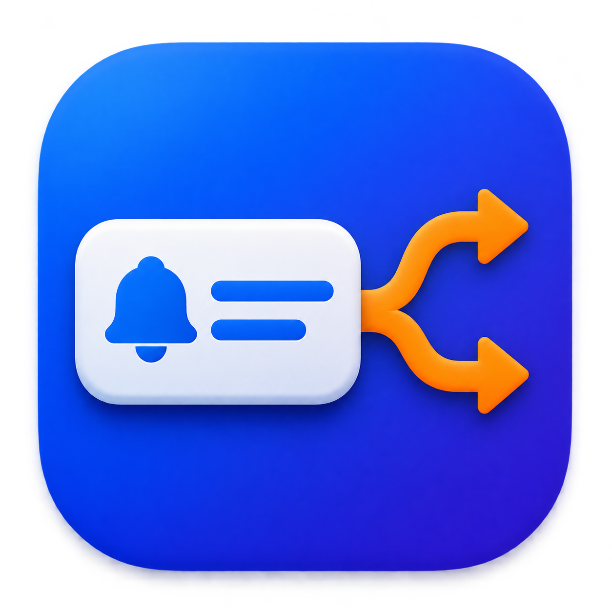
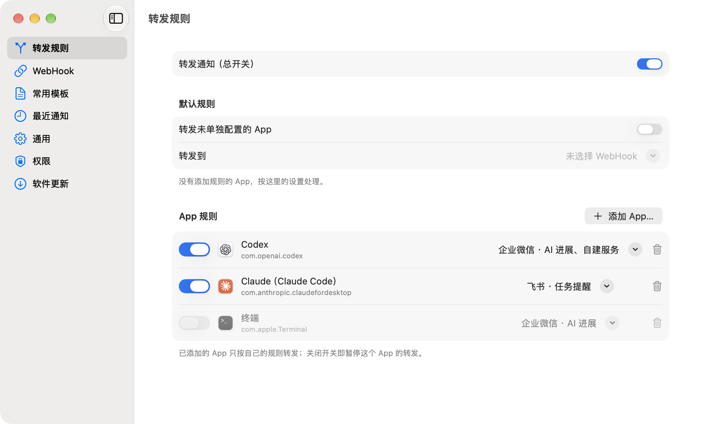
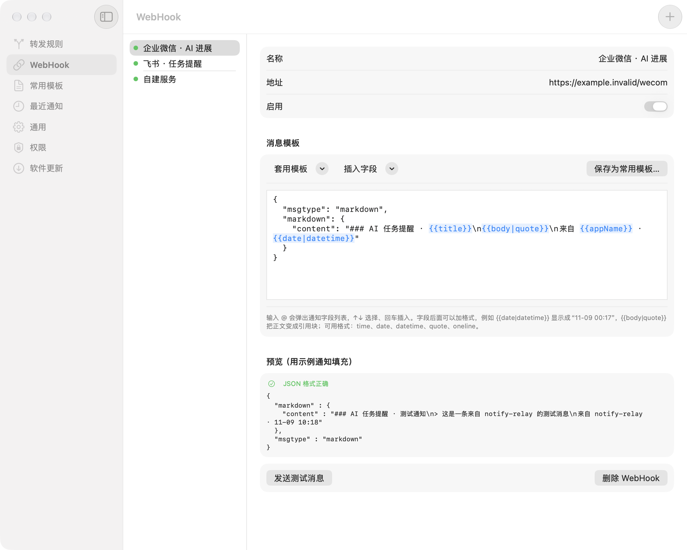
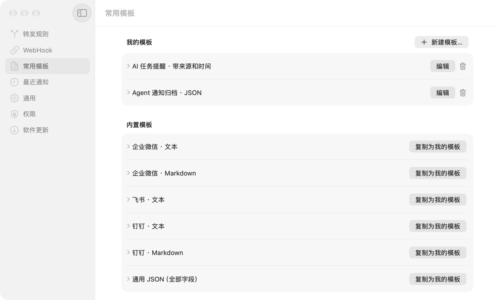
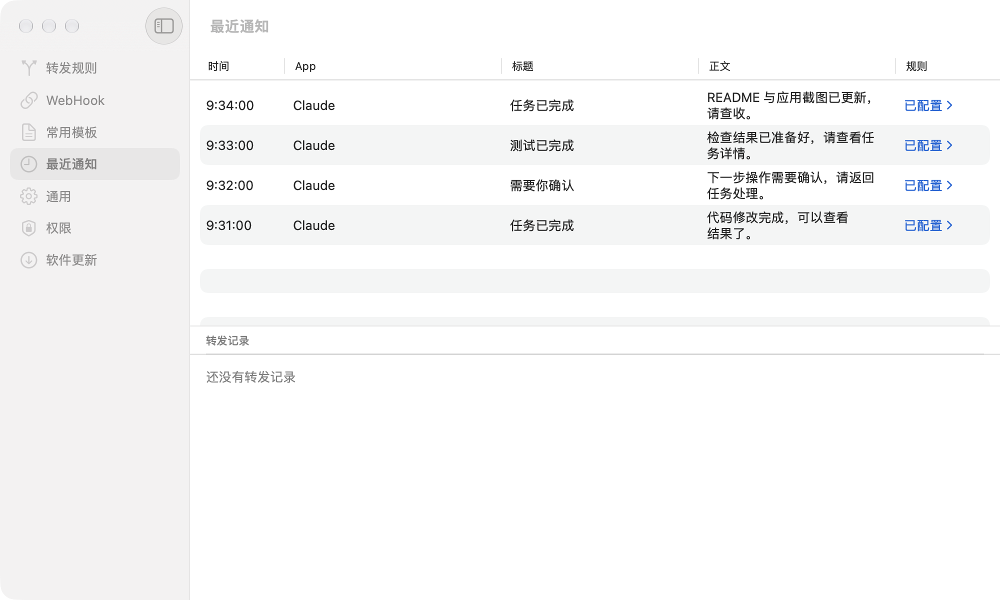

  

<h1 align="center">捎信 SendWord</h1>

把电脑上的提醒，捎到你身边。

**捎信（SendWord）是一款 macOS 通知转发工具。** 让 Codex、Claude Code 等 AI Agent 工具在 Mac 上继续工作，你可以离开电脑。捎信把它们发出的系统通知通过 Webhook 转发到企业微信、飞书、钉钉或你的自建服务，让你在手机上及时看到任务完成、等待确认等提醒，知道什么时候需要回来处理。

SendWord is a macOS notification forwarding app that sends notifications from Codex, Claude Code, and other apps to WeCom, Feishu, DingTalk, or custom webhooks.

[下载最新版](https://github.com/erjin-zhi/send-word/releases/latest) · [安装](#安装) · [开始使用](#开始使用) · [界面预览](#界面预览) · [常见问题](#常见问题)

## 能帮你做什么

- **不用一直守着电脑**：AI 工具有新通知，手机上也能收到提醒。
- **多个工具分别管理**：Codex 发到企业微信，Claude 发到飞书，也能把一条通知发往多个目标。
- **消息内容自己定**：直接套用平台模板，按需加入来源、标题、正文和时间，编辑时就能看到预览。
- **收到什么、发到哪里都能看**：最近通知和转发结果集中展示，方便检查提醒有没有发出去。
- **在菜单栏安静运行**：可设置登录 Mac 时自动启动，随时暂停、恢复或打开设置，无需部署中转服务器。

图中以 Codex 和 Claude（Claude Code）为例。所有截图均使用演示配置与示例通知，不含真实密钥或私人消息。

## 安装

**系统要求：macOS 15 或更新版本，Apple 芯片 Mac（M 系列）。**

1. 前往 [下载页面](https://github.com/erjin-zhi/send-word/releases/latest)，在 **Assets** 中下载 `send-word-版本号.zip`。
2. 解压后，将 `SendWord.app` 拖入「应用程序」文件夹。
3. 打开应用，首次启动会显示设置窗口；之后点击菜单栏的铃铛图标即可进入设置。

改名前发布的版本仍使用 `notify-relay-版本号.zip` 和 `notify-relay.app`，安装方式相同。

当前版本尚未经过 Apple 公证。如果首次打开时提示无法验证开发者，请确认安装包来自上面的项目发布页，再前往「系统设置 → 隐私与安全性」，找到捎信并点击「仍要打开」。详见 [Apple 的首次打开说明](https://support.apple.com/zh-cn/102445)。

## 开始使用

### 1. 授权读取通知

打开「权限」，点击「授权读取通知…」。弹出的窗口已定位到通知文件夹，直接点击「授权」，看到「已连接，正在读取新通知」即可。

如果仍无法读取，按页面引导打开系统设置，为捎信开启「完全磁盘访问权限」，然后重新检测或重启应用。

### 2. 设置手机接收消息的地方

在企业微信、飞书或钉钉中准备一个群机器人，复制它的 **Webhook 地址**，也就是机器人用来接收消息的地址。

打开「WebHook」页，添加目标、填入名称和地址，在「套用模板」中选择对应平台，再点击「发送测试消息」。手机上收到这条测试消息，就说明接收端配置成功了；记得打开手机端对应 App 和群聊的消息提醒。

目前暂不支持飞书、钉钉机器人的签名校验，请使用符合接收端安全要求且无需签名校验的机器人，或选择其他接收方式。

### 3. 选择要关注的 AI 工具

打开「转发规则」，点击「添加 App…」，选择 Codex、Claude 等来源，并勾选刚才配置的接收目标。也可以在「最近通知」中找到工具发来的通知，直接点击「添加规则」。

确认总开关、App 规则和接收目标都已开启，再让 AI 工具产生一条**新的系统通知**，查看手机是否收到。

捎信转发的是工具已经发出的 macOS 系统通知，因此需要开启来源工具的通知。使用终端里的 AI 工具时，请以「最近通知」中显示的实际来源为准来添加规则。

## 日常使用

- **登录后自动启动**：打开「通用」，开启「登录 Mac 时自动启动」。如果提示需要系统允许，点击「打开系统登录项设置…」完成设置；之后登录 Mac 时会自动在菜单栏运行。
- **暂停或恢复**：点击菜单栏铃铛，切换「转发通知」；也可以只暂停某个 App 或某个接收目标。
- **添加更多工具**：在「最近通知」中点击「添加规则」，已有规则可以直接跳转修改。未配置的 App 默认不会转发；需要时再开启「转发未单独配置的 App」，并选择接收目标。
- **调整提醒内容**：在「WebHook」页套用或修改模板，输入 `@` 插入通知字段。常用格式可以保存下来复用。
- **检查更新**：打开「软件更新」检查新版，也可以开启自动下载安装。

## 界面预览

### 手机上的提醒，保留你关心的信息

用模板组合来源 App、标题、正文和时间，下方可直接预览效果，也能发送测试消息确认。

### 常用格式保存一次，下次直接套用

内置企业微信、飞书、钉钉等平台模板，可以直接使用，也可以复制修改后保存为自己的模板。

### 通知和转发结果，一处查看

查看 AI 工具发来的提醒，直接添加或调整规则；手机没有收到消息时，也可以在这里查看发送结果；双击一条转发记录，能看到原始通知、实际发给 WebHook 的内容和平台返回的原文。

图中是示例历史通知，因此转发记录为空；应用只转发连接后收到的新通知。

## 常见问题

### 手机没收到提醒，先检查什么？

先在「WebHook」页发送测试消息。如果测试失败，检查地址、所选平台模板和页面提示；如果测试成功但手机没有提醒，检查手机端的通知权限、群聊免打扰设置，并确认群里是否收到消息。

### 测试成功了，为什么 AI 工具的通知没转发？

测试消息只验证接收端。请确认「权限」页已连接，再看「最近通知」是否出现了工具的新通知，以及该通知的来源是否配置了正确目标、相关开关是否开启。来源工具没有发出系统通知时，捎信也不会收到任务进展。

### 电脑合盖、睡眠或退出应用后，还能收到吗？

Mac 需要保持唤醒、联网，捎信需要保持运行。电脑睡眠或应用退出后无法继续转发；开启「通用 → 登录 Mac 时自动启动」后，下次登录会自动运行。手动退出应用后，需要重新打开才能恢复转发。

### 旧通知、暂停期间的通知会补发吗？

不会。历史通知仅供查看，暂停期间读取到的通知也不会在恢复后补发。发送失败暂时不会自动重试，可在「最近通知」中查看失败原因。

### 能在手机上直接回复或确认 AI 的操作吗？

捎信负责把提醒送到手机，不提供远程对话或审批功能。收到需要处理的通知后，请回到相应任务中操作。

### 授权后仍然读不到通知怎么办？

展开「权限 → 技术细节」，点击「重新检测」。仍无法读取时，重新授权通知文件夹，或按页面引导开启完全磁盘访问权限后重启应用；「技术细节」中可以查看具体原因。

## 隐私与反馈

通知在本机读取，消息直接发送到你配置的接收端，不经过项目方的中转服务。请只选择需要转发的 App，并使用可信的接收地址；Webhook 地址可能包含密钥，配置在本机明文保存，分享截图或反馈问题时请遮住地址和私人通知内容。

遇到问题或有建议，欢迎 [提交 Issue](https://github.com/erjin-zhi/send-word/issues)。请附上 macOS 版本、应用版本、遇到的现象和页面提示。

需要更多设置细节时，可查看 [转发规则与模板参考](docs/advanced-usage.md)；源码构建、调试与发布说明见 [开发文档](docs/development.md)。
